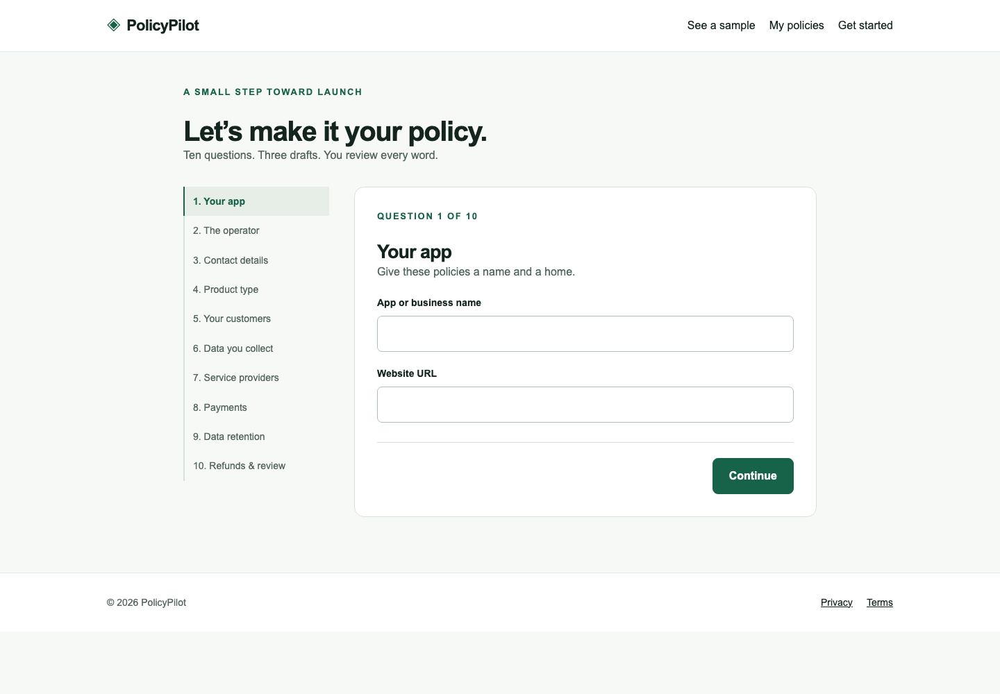
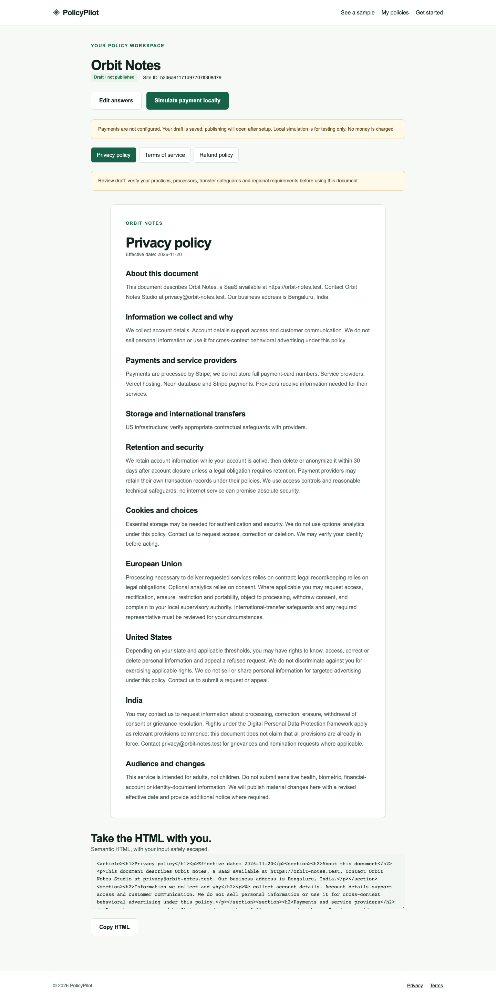
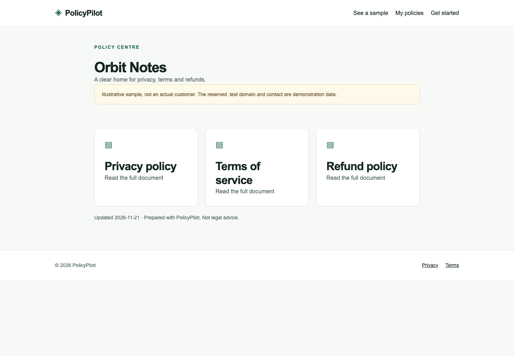
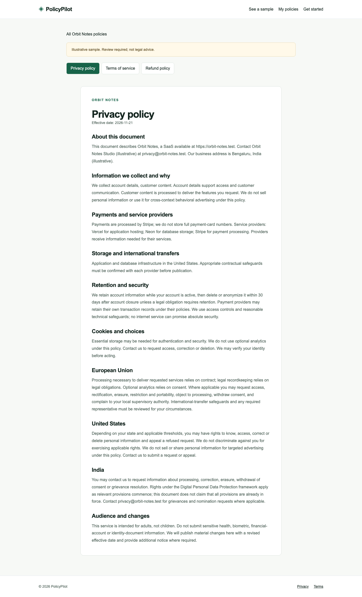
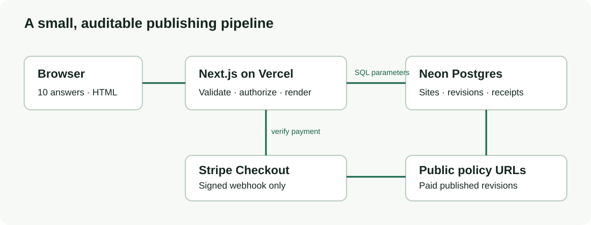
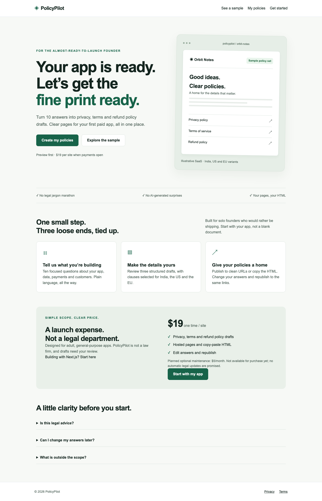
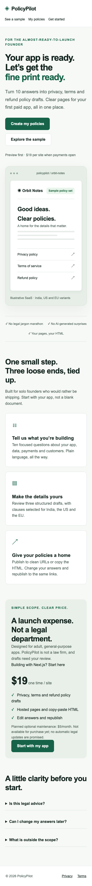
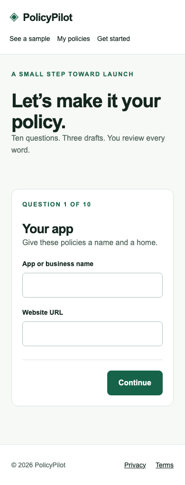
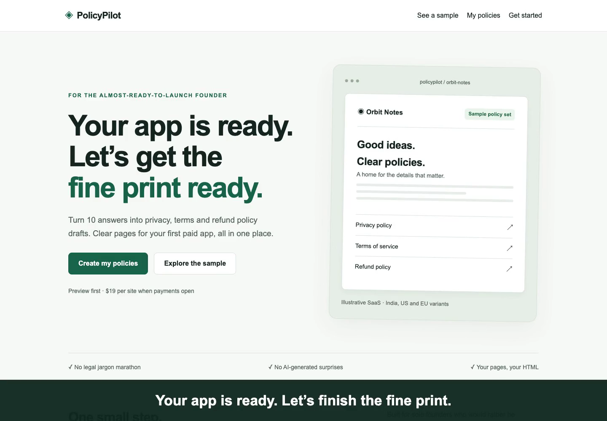

<p align="center"></p>
<p align="center">Ten questions. Three policy drafts. One less loose end before launch.</p>
<p align="center"><a href="https://nextjs.org/"></a> <a href="LICENSE"></a> <a href="package.json"></a> <a href="https://policypilot-mauve.vercel.app"></a></p>

## The problem

“I finished the app. What do I put in the footer?” That is the workflow this project targets, not a customer testimonial. A solo founder shipping their first paid app needs privacy, terms and refund documents that describe what the app actually does. A blank template and a pile of compliance settings are both a lot to face on launch day.

## How we felt it

The concrete trigger was the launch checklist: a working checkout still leaves three legal-page links to fill in. PolicyPilot was built around that handoff, from describing an app to reviewing and maintaining its policy set. This is a product rationale, not an invented founder origin story.

## What we built

**A focused intake.** Ten grouped questions cover the app, operator, contact, audience, data, processors, payments, retention and refunds.



**Three reviewable drafts.** A deterministic clause library selects India, US and EU variants. It never sends your information to an AI model. These are drafts, not legal advice or a compliance guarantee.



**A clean home, plus HTML.** Paid publishing gives each policy a stable URL. The workspace exports escaped, semantic HTML for your own site.



**Answers that can change.** Return with a private recovery key, edit the intake and republish to the same URLs. Database revisions preserve the published history.



Current release: a functional preview. Stripe checkout integration is implemented but not configured for real purchases. The local recorded payment is explicitly simulated. Optional $5/month maintenance is planned, not sold. Professional clause review and private support setup remain release gates.

## How it works



1. Next.js validates the ten answers using a shared typed schema.
2. Pure functions select regional clauses and generate structured documents.
3. Neon stores sites, key hashes, immutable revisions and payment receipts.
4. A verified Stripe webhook grants paid publishing; browser redirects never do.
5. React escapes hosted content; a separate escaping function protects HTML exports.

## Quickstart

Node 22+ is required. Local mode uses isolated files and simulated payments, never production Neon.

```sh
git clone https://github.com/SayedZahur786/policypilot.git && cd policypilot
npm ci
cp .env.example .env.local
npm run dev
```

Open http://localhost:3000. The repository is private, so cloning requires access. Recovery keys are shown once: save yours. For production setup, migration, environment variables and exact launch blockers, see [LAUNCH.md](LAUNCH.md). Never enable `POLICYPILOT_LOCAL` on a deployment; the code additionally refuses it on Vercel.

## Screenshots

Real Playwright captures of the production build, with 1440px desktop and 390px mobile viewports. See [all captures](docs/screenshots).


<p align="center"> </p>

Regenerate with `npm run screenshots`. The committed [shots.spec.ts](tests/shots.spec.ts) starts the production server and checks every main route for horizontal overflow before capture.

## Demo video

[](docs/demo.mp4)

[Play or download the MP4](docs/demo.mp4). Real browser footage, spoken narration and large captions; local simulated payment is clearly identified. [Storyline](docs/demo-story.md) · [Recording script](scripts/demo.ts).

## Why this is interesting

- **Deterministic clauses over per-request generation.** Auditable outputs and predictable cost, at the expense of a deliberately limited product scope and a need for professional review.
- **Immutable published revisions.** A stable URL points at the latest paid revision. Signed, idempotent payment handling prevents duplicate publication; a success redirect is never proof of payment.
- **Capability-based editing.** Only hashes of high-entropy recovery keys are stored. This avoids an email-provider dependency, but losing a key requires operator intervention and sharing it shares control.

[Research and plan](PLAN.md) · [Decisions](DECISIONS.md) · [Security review](docs/security-audit.md) · [Validation evidence](docs/validation.md). No testimonials, customer counts or revenue claims are asserted here.
